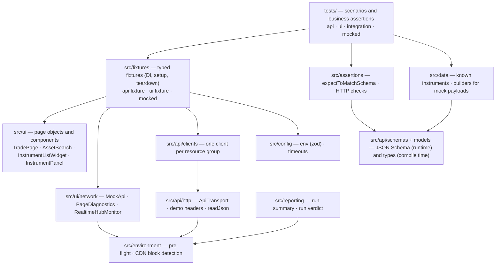
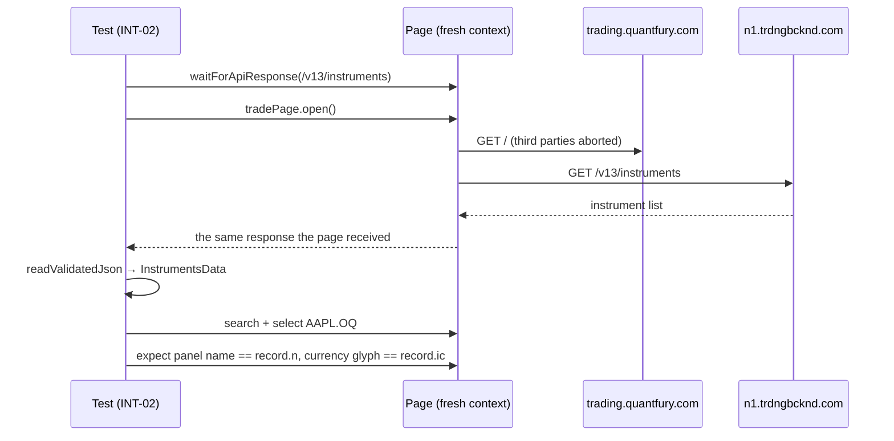

# Architecture

How the framework is layered, how fixtures wire it together and how data flows through a test.
Decisions behind it are in [decisions/](decisions/).

## Layers

| Layer                               | Responsibility                                                                                                                                                                                                                    | Does not                                                      |
| ----------------------------------- | --------------------------------------------------------------------------------------------------------------------------------------------------------------------------------------------------------------------------------- | ------------------------------------------------------------- |
| `tests/`                            | Scenario (Arrange–Act–Assert), business expectations, tags                                                                                                                                                                        | Build requests, know selectors                                |
| `src/fixtures/`                     | Create and dispose contexts, clients, page objects, mocks, diagnostics; attach diagnostics on failure                                                                                                                             | Assert business rules                                         |
| `src/ui/pages`, `src/ui/components` | Locators and user actions of the Trade screen                                                                                                                                                                                     | Contain assertions or waits on fixed times                    |
| `src/ui/network`                    | Route mocks, bounded page diagnostics, response capture; SignalR envelope decoding (`signalr-messages`, `HubTraffic`), live observation (`RealtimeHubMonitor`) and a pass-through hub proxy for disconnect scenarios (`HubProxy`) | Change product behavior outside one test; store push payloads |
| `src/api/clients`                   | Observed endpoints with typed parameters; return raw `APIResponse`                                                                                                                                                                | Parse or validate bodies, retry                               |
| `src/api/http`                      | Transport with a redacted exchange log, required demo headers, JSON reading                                                                                                                                                       | Interpret status codes                                        |
| `src/api/models`, `src/api/schemas` | Compile-time types and runtime JSON Schemas of observed payloads                                                                                                                                                                  | Forbid unknown properties                                     |
| `src/assertions`                    | Narrow reusable checks with readable messages (`expectToMatchSchema` narrows `unknown`)                                                                                                                                           | Hide failures                                                 |
| `src/data`                          | Test data (known instruments) and schema-validated mock builders                                                                                                                                                                  | Hold private data                                             |
| `src/config`                        | Validated configuration and per-kind timeouts                                                                                                                                                                                     | Contain hosts that were not observed                          |
| `src/environment`                   | Pre-flight availability check; recognize CDN block/challenge pages                                                                                                                                                                | Bypass them                                                   |
| `src/reporting`                     | Run summary (console, GitHub job summary) and `reports/run-verdict.json`                                                                                                                                                          | Change results                                                |
| `bdd/features`, `bdd/steps`         | Gherkin scenarios and step definitions on the shared fixtures (`bdd/steps/fixtures.ts` merges them with playwright-bdd)                                                                                                           | Contain page or HTTP logic; `.features-gen/` is generated     |

There is no `BasePage` and no generic wrapper around Playwright's API; page objects compose
components.

## Fixtures

All suites import one `test` (`src/fixtures/index.ts`, `mergeTests(apiTest, uiTest)`); the mocked
suite imports `src/fixtures/mocked.ts`, which extends it.

| Fixture                                  | Scope      | Provides                                                              | Teardown                                                                                                    |
| ---------------------------------------- | ---------- | --------------------------------------------------------------------- | ----------------------------------------------------------------------------------------------------------- |
| `deviceId`                               | test       | Random demo identity                                                  | —                                                                                                           |
| `apiExchangeLog`                         | test       | Bounded, redacted HTTP log                                            | Attach `api-exchanges.json` on failure; annotate `environment` if a CDN block was seen                      |
| `api`, `apiWithoutDemoHeaders`           | test       | Clients over an own `APIRequestContext` (with / without demo headers) | Dispose the context                                                                                         |
| `page` (extended)                        | test       | Fresh context; third-party hosts aborted; diagnostics listening       | Detach listeners; attach `page-diagnostics.json` on failure; annotate `environment` if a CDN block was seen |
| `pageDiagnostics`, `networkExpectations` | test       | Diagnostics buffer; failures provoked on purpose                      | —                                                                                                           |
| `tradePage`                              | test       | `TradePage` for this page (not opened)                                | Annotate `slow-start` when start-up > 6 s                                                                   |
| `accessibility`                          | test       | axe-core scanner for this page (WCAG 2.0/2.1 A, AA)                   | Each scan attaches `axe-<label>.json` (rule, impact, node count, examples)                                  |
| `mockApi`                                | test       | Narrow per-endpoint mocks                                             | `unrouteAll`; attach `mocked-requests.json` on failure                                                      |
| `instrumentSnapshot`                     | **worker** | Validated, frozen full instrument list (immutable)                    | —                                                                                                           |

UI fixtures are lazy: an API-only test never starts a browser.

## Data flow of a live UI/API consistency test

## Diagnostics on failure

| Attachment                                     | Content                                                                                                                        | Limits                                                         |
| ---------------------------------------------- | ------------------------------------------------------------------------------------------------------------------------------ | -------------------------------------------------------------- |
| screenshot, trace (first retry), error context | Playwright built-ins                                                                                                           | Traces only on retry; `npm run test:trace` records them always |
| `api-exchanges.json`                           | Method, URL, status, selected headers, request body, response body                                                             | Last 50, bodies ≤ 2,000 chars, session-like values masked      |
| `page-diagnostics.json`                        | Page/console errors, failed requests, HTTP errors (with CDN block detection), requests still in flight, WebSocket frame counts | 100 events, 10 sockets, payloads never stored                  |
| `mocked-requests.json`                         | Requests a mock intercepted                                                                                                    | Last 50                                                        |

## Run lifecycle

1. `globalSetup` checks the web app, the bootstrap host, the demo API and the instrument-list
   path; if the demo cannot be used, the run stops with `ENVIRONMENT UNAVAILABLE (<reason>)`.
2. Tests run per project (`api-live`, `ui-chromium`, `ui-firefox-smoke`, `ui-webkit-smoke`,
   `ui-mocked`) with tag-based selection.
3. The summary reporter prints counts, environment-caused failures, flaky tests, quarantined tests
   and slow starts, writes the GitHub job summary and `reports/run-verdict.json`.
4. In CI, `evaluate-run.mjs` turns the verdict into the job result (gate or signal, ADR 0001).
